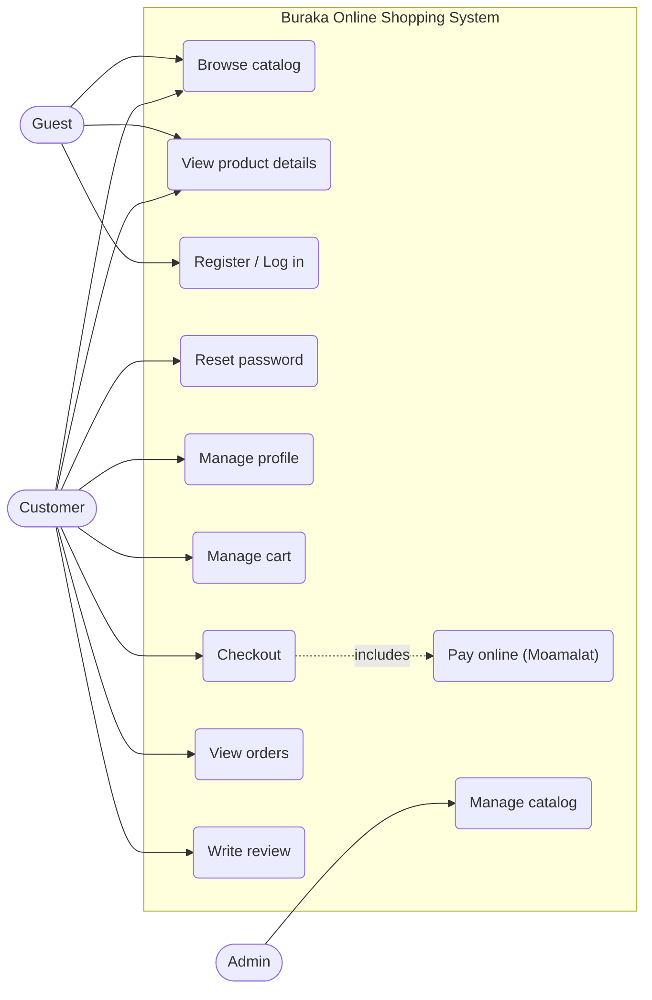

# 2. System Overview

## 2.1 System Description

Buraka is an Online Shopping System for the Libyan market. Customers browse a catalog of products organized in a parent/child category tree and tagged with brands, add products to a cart, check out, pay online via the Moamalat payment gateway (or choose cash on delivery), and review products they purchased. Administrators manage the catalog.

The system is served to two client applications: a **Flutter mobile app** and a **React web app**. Both communicate with the backend exclusively through an API Gateway over HTTPS/REST.

## 2.2 System Users

| Actor | Description | Clients |
| --- | --- | --- |
| Customer | Registered shopper who browses, buys, pays, and reviews | Flutter mobile, React web |
| Guest | Unregistered visitor; may browse the catalog only | Flutter mobile, React web |
| Admin | Back-office user managing products, categories, and brands | React web |

External systems:

| System | Role |
| --- | --- |
| Moamalat Payment Gateway | Processes online card payments via a hosted payment page; reports results through HMAC-SHA256-signed server callbacks |
| Email Provider (SMTP) | Delivers transactional email (password reset codes, order confirmations) |

## 2.3 System Features

| # | Feature | Actor |
| --- | --- | --- |
| F1 | Register, log in, manage profile, reset password | Customer |
| F2 | Browse products with filtering (category, brand), search, and pagination | Guest, Customer |
| F3 | View product details: images, colors, price, stock, average rating, reviews | Guest, Customer |
| F4 | Manage cart: add items (with color selection), update quantities, remove items | Customer |
| F5 | Check out: create an order from the cart, choose payment method | Customer |
| F6 | Pay online via Moamalat hosted payment page, or select cash on delivery | Customer |
| F7 | View order history and order status (paid, delivered) | Customer |
| F8 | Write, update, and delete reviews (title, 1–5 rating) for purchased products | Customer |
| F9 | Manage products, categories (parent/child tree), and brands | Admin |

## 2.4 Use Case Diagram (Optional per course — included)

Guests can only browse; every other feature requires an authenticated Customer or Admin. Feature F8 enforces "purchased products only" at the service level (see `03-requirements.md`, FR-REV-01).
