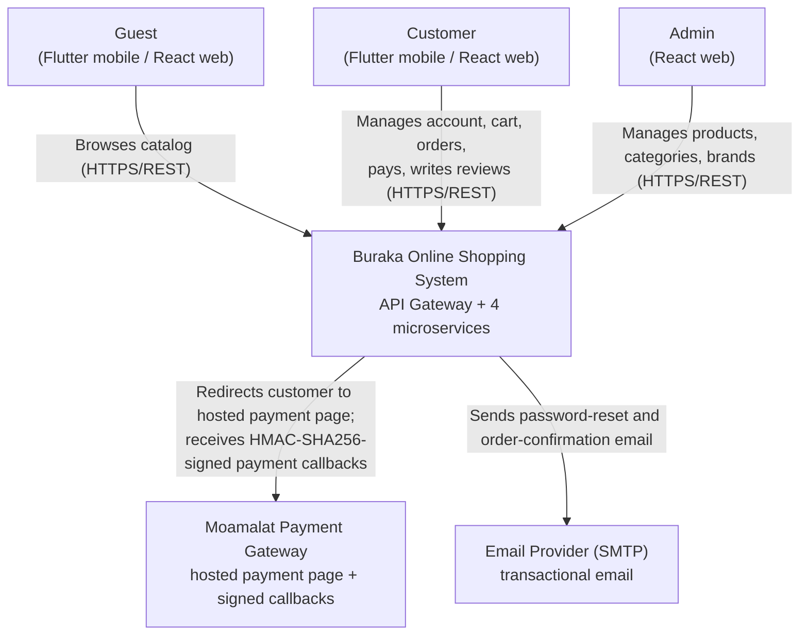
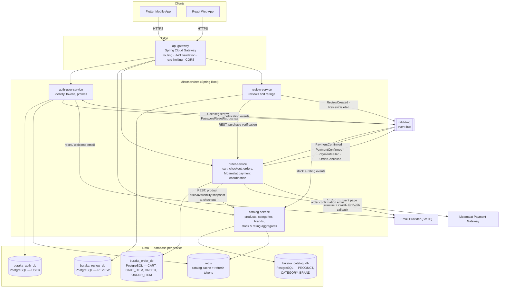
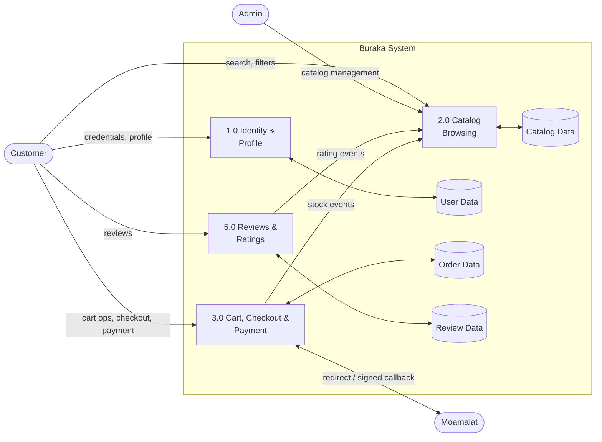

# 6. Architecture Diagrams

Course-mandatory diagrams are the System Context Diagram and the Component Diagram. Sequence diagrams and a data flow diagram are optional per the course and are included because they clarify the payment and event flows.

## 6.1 System Context Diagram (Required)



## 6.2 Component Diagram (Required)



## 6.3 Sequence Diagram: Checkout and Moamalat Payment (Optional — included)

```mermaid
sequenceDiagram
    actor C as Customer
    participant FE as Flutter/React Client
    participant GW as api-gateway
    participant OS as order-service
    participant CS as catalog-service
    participant DB as buraka_order_db
    participant MQ as rabbitmq
    participant MM as Moamalat

    C->>FE: Checkout cart
    FE->>GW: POST /api/orders (JWT)
    GW->>GW: Validate JWT (RS256)
    GW->>OS: Forward request with identity headers
    OS->>CS: GET /api/products/{ids} — price & availability snapshot
    CS-->>OS: Product snapshots
    OS->>DB: Persist ORDER (isPaid=false) + ORDER_ITEMs (outbox: OrderPlaced)
    OS->>MQ: Publish OrderPlaced
    OS->>OS: Build Moamalat payment URL (HMAC-SHA256 secure hash)
    OS-->>FE: 201 Created + paymentUrl
    FE->>MM: Redirect customer to hosted payment page
    C->>MM: Pay with card
    MM->>OS: POST /api/payments/moamalat/callback (HMAC-SHA256 signed)
    OS->>OS: Verify HMAC; on success set isPaid=true, paidAt
    OS->>MQ: Publish PaymentConfirmed (or PaymentFailed)
    MQ-->>CS: Consume PaymentConfirmed → confirm stock decrement, sold += qty
    MQ-->>OS: Consume PaymentConfirmed → send order confirmation email
```

## 6.4 Sequence Diagram: Review Submission and Rating Update (Optional — included)

```mermaid
sequenceDiagram
    actor C as Customer
    participant GW as api-gateway
    participant RS as review-service
    participant OS as order-service
    participant RDB as buraka_review_db
    participant MQ as rabbitmq
    participant CS as catalog-service

    C->>GW: POST /api/reviews (JWT)
    GW->>RS: Forward with identity headers
    RS->>OS: GET /api/orders?productId={id}&paid=true (purchase verification)
    OS-->>RS: 200 OK (purchased) — otherwise 403
    RS->>RDB: Persist REVIEW
    RS->>MQ: Publish ReviewCreated {productId, rating}
    MQ-->>CS: Consume → recalculate ratingsAverage and ratingsQuantity; invalidate product cache keys
```

## 6.5 Data Flow Diagram — Level 0 (Optional — included)



Level-0 DFD showing logical processes aligned with the microservice decomposition; payment coordination is part of order-service.
