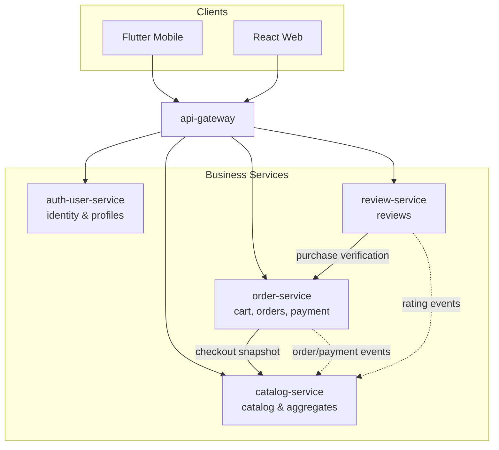
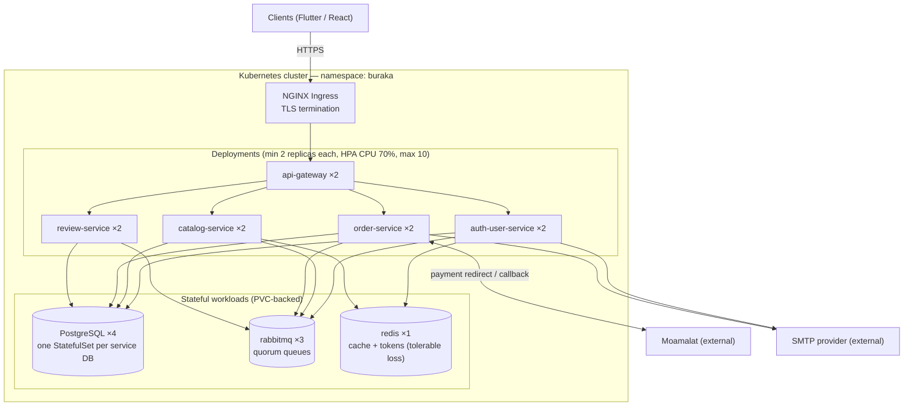

# 7. Architecture Views (4+1)

## 7.1 Logical View

The system's functionality is organized into four business services plus an edge component, each a single-responsibility unit with a well-defined interface (see `05-system-components.md` for the full endpoint and event catalog):



- **api-gateway:** routing, JWT validation, rate limiting, CORS.
- **auth-user-service:** the only component that knows credentials; issues and rotates tokens.
- **catalog-service:** the read-heavy core; sole writer of PRODUCT/CATEGORY/BRAND; maintains stock and rating aggregates from events.
- **order-service:** the write-critical core; owns the order lifecycle and the Moamalat integration.
- **review-service:** feedback; validates purchases before accepting reviews.

## 7.2 Development View

One mono-repository with a Gradle multi-module build; each service is an independent Spring Boot module producing its own JAR and Docker image.

```text
buraka-back/
├── build.gradle / settings.gradle          # multi-module root
├── modules/
│   ├── api-gateway/                        # Spring Cloud Gateway
│   ├── auth-user-service/
│   ├── catalog-service/
│   ├── order-service/
│   └── review-service/
└── shared/
    └── event-contracts/                    # event names + payload DTOs (the only shared code)
```

Inside each service module, standard layered packaging:

```text
org.ali.projects.buraka.<service>/
├── controller/    # REST endpoints
├── service/       # business logic
├── repository/    # Spring Data JPA
├── entity/        # JPA entities (owned tables only)
├── dto/           # request/response objects
├── messaging/     # RabbitMQ publishers/consumers
└── config/        # security, cache, broker config
```

Rules: services never import each other's modules; `shared/event-contracts` is the only cross-service dependency; every module builds and tests independently in CI.

## 7.3 Process View

At runtime the system is a set of OS processes (containers): 1 gateway, 4 services, rabbitmq, redis, 4 PostgreSQL processes. Two interaction patterns dominate:

**Synchronous request path** (e.g., browsing a product):

```mermaid
sequenceDiagram
    participant FE as Client
    participant GW as api-gateway
    participant CS as catalog-service
    participant RD as redis
    participant DB as buraka_catalog_db

    FE->>GW: GET /api/products/{slug}
    GW->>GW: Validate JWT (if present); rate-limit check
    GW->>CS: Forward
    CS->>RD: Cache lookup (product:{slug})
    alt cache hit
        RD-->>CS: Cached DTO
    else cache miss
        CS->>DB: SELECT product + images + brand
        CS->>RD: Populate cache with TTL
    end
    CS-->>FE: 200 OK product detail
```

**Asynchronous event path** (payment saga — the system's critical consistency flow): see `06-architecture-diagrams.md` §6.3. The key runtime properties: consumers are idempotent, queues are durable quorum queues, and order-service writes events to an outbox table in the same transaction as the state change, so a crash cannot lose an event (NFR-REL-01).

**Payment callback path:** Moamalat's server-to-server callback is the only unauthenticated entry past the gateway's JWT rule; it is protected by HMAC-SHA256 signature verification instead (NFR-SEC-02) and rate-limited separately.

## 7.4 Physical View

Documented target: Kubernetes + Docker. No cloud subscription is used; the topology below is the design target (validatable later on Docker Desktop Kubernetes — this project produces no manifests).



Key physical decisions: every service runs ≥2 replicas behind a Kubernetes Service (NFR-AVL-01); HPA scales any service independently to 10 replicas (NFR-SCA-01); PostgreSQL instances are separate StatefulSets so a busy database never neighbors a failing one; secrets (DB credentials, Moamalat HMAC key, JWT keys) live in Kubernetes Secrets, never in images.

## 7.5 Use Case View

The architecture is validated against the primary scenarios from `02-system-overview.md`:

| Scenario | Path through the architecture |
| --- | --- |
| Customer browses catalog | Client → api-gateway → catalog-service (redis-cached) → buraka_catalog_db |
| Customer registers / logs in | Client → api-gateway → auth-user-service → buraka_auth_db; tokens in redis; UserRegistered event → welcome email |
| Customer checks out and pays | Full saga in `06-architecture-diagrams.md` §6.3: order-service ↔ catalog-service (REST snapshot), Moamalat hosted page, HMAC-verified callback, PaymentConfirmed event → stock decrement + confirmation email |
| Customer writes a review | review-service verifies purchase via order-service, persists REVIEW, publishes ReviewCreated → catalog-service updates rating aggregates |
| Admin manages catalog | React web → api-gateway → catalog-service admin endpoints → buraka_catalog_db; cache invalidation on writes |

These five scenarios exercise every service, every database, both communication styles, both external systems, and the cache — nothing in the architecture is unused.
