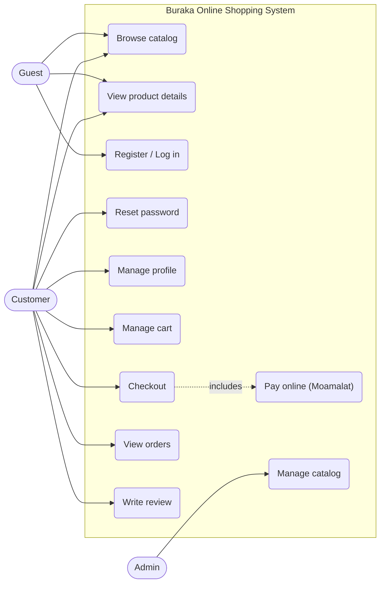
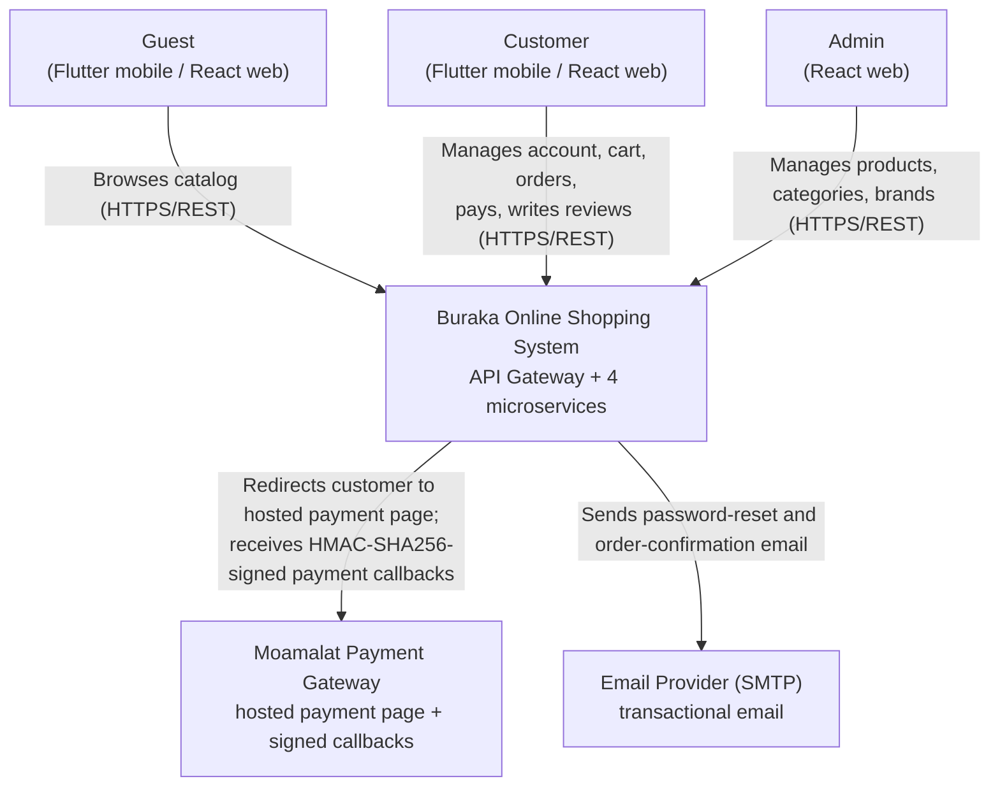
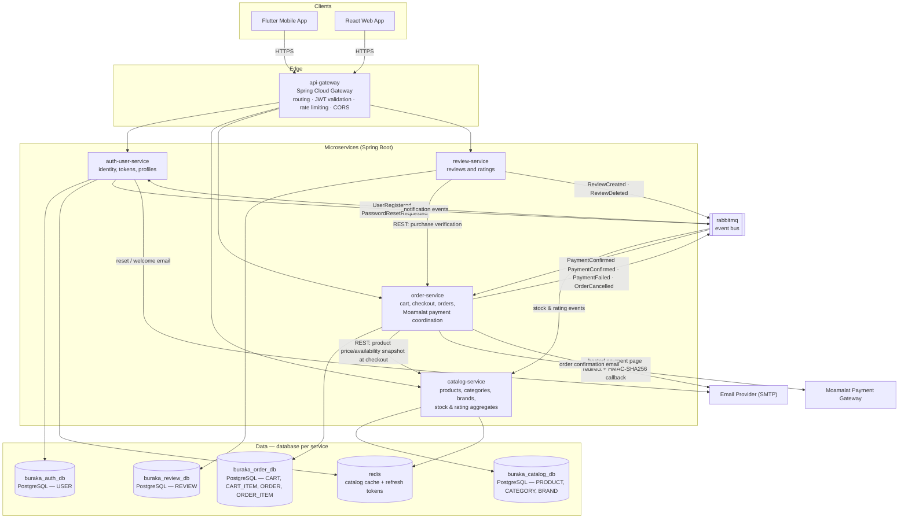
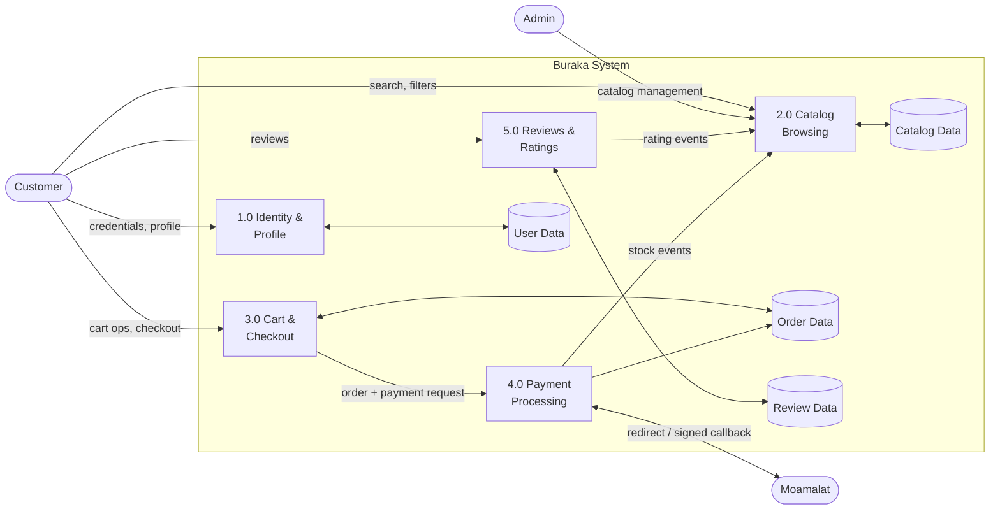
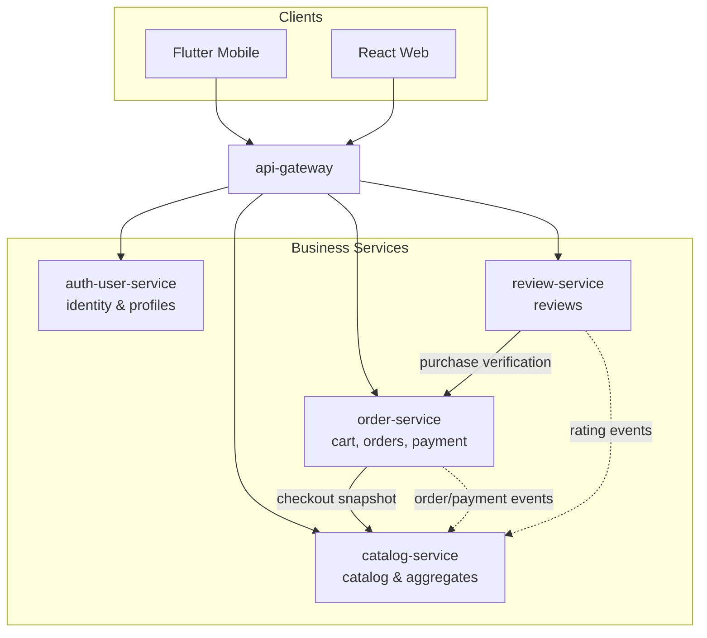
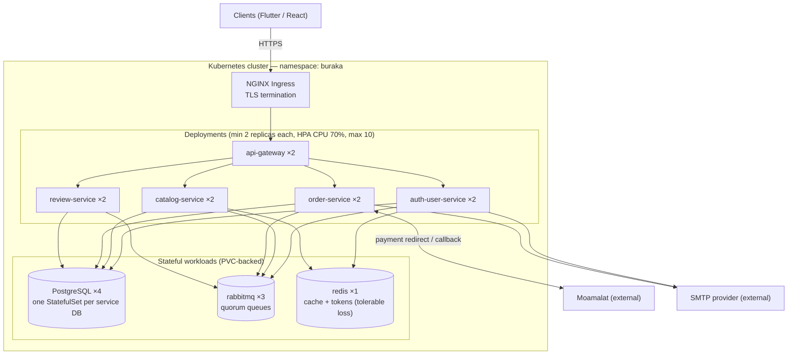

# Buraka Architecture Documentation Implementation Plan

> **For agentic workers:** REQUIRED SUB-SKILL: Use superpowers:subagent-driven-development (recommended) or superpowers:executing-plans to implement this plan task-by-task. Steps use checkbox (`- [ ]`) syntax for tracking.

**Goal:** Produce the complete Software Architecture Document for Buraka (Online Shopping System) as a multi-file Markdown document under `buraka-docs/architecture/`, following the course report template exactly.

**Architecture:** Eleven Markdown files (index + 10 course sections) containing Mermaid diagrams, requirement tables, component/interface catalogs, 4+1 views, and quality-attribute analysis. All content is constrained by the decisions in `buraka-docs/project-requirements/README.md` (sections C1–C7).

**Tech Stack:** Markdown, Mermaid diagrams, Git for version control.

## Global Constraints

Every task implicitly includes these requirements. Values are copied verbatim from `buraka-docs/project-requirements/README.md` and `buraka-docs/ERD/README.md`.

- Language: English only, in every file.
- All diagrams are Mermaid inside fenced ` ```mermaid ` code blocks (renders on GitHub). No image files, no external diagram tools.
- Document structure follows the course template exactly: Introduction, System Overview, Requirements, Software Architecture, System Components, Architecture Diagrams, Architecture Views (4+1), Quality Attributes, Technology Stack, Conclusion.
- Files live under `buraka-docs/architecture/`; the index is `buraka-docs/architecture/README.md`.
- Deliverable is a document only — no implementation code, no local K8s simulation.
- Scale assumptions (anchor for all numbers): ~10K registered users, ~1K daily active users, ~100 orders/day.
- Quality attribute analysis depth: Scalability deepest → Availability second → Performance and Security standard → Maintainability and Reliability lighter.
- Payment: Moamalat hosted payment page + HMAC-SHA256 callback, designed but explicitly marked "not implemented".
- Existing Spring Boot skeleton (`buraka-back/Buraka`) is ignored by this document.
- The working directory is not yet a git repository; Task 1 initializes it.

### Canonical Naming Registry

All tasks MUST use these exact names. Later tasks reference them; do not invent variants.

**Services:**

| Name | Technology | Owns |
| --- | --- | --- |
| `api-gateway` | Spring Cloud Gateway | routing, JWT validation, rate limiting, CORS |
| `auth-user-service` | Spring Boot (Java 17) | `USER` |
| `catalog-service` | Spring Boot (Java 17) | `PRODUCT`, `CATEGORY`, `BRAND` |
| `order-service` | Spring Boot (Java 17) | `CART`, `CART_ITEM`, `ORDER`, `ORDER_ITEM` |
| `review-service` | Spring Boot (Java 17) | `REVIEW` |

**Databases (database per service):** `buraka_auth_db`, `buraka_catalog_db`, `buraka_order_db`, `buraka_review_db` — all PostgreSQL.

**Infrastructure:** `rabbitmq` (event bus, quorum queues), `redis` (catalog cache + refresh-token store), NGINX Ingress.

**RabbitMQ events (exact names):**

| Event | Published by | Consumed by | Payload summary |
| --- | --- | --- | --- |
| `UserRegistered` | auth-user-service | auth-user-service notification module | userId, email |
| `PasswordResetRequested` | auth-user-service | auth-user-service notification module | userId, email, resetCode |
| `OrderPlaced` | order-service | catalog-service | orderId, items[{productId, quantity}] |
| `PaymentConfirmed` | order-service | catalog-service, order-service notification module | orderId, items[{productId, quantity}], paidAt |
| `PaymentFailed` | order-service | catalog-service | orderId, items[{productId, quantity}], reason |
| `OrderCancelled` | order-service | catalog-service | orderId, items[{productId, quantity}] |
| `ReviewCreated` | review-service | catalog-service | reviewId, productId, rating |
| `ReviewDeleted` | review-service | catalog-service | reviewId, productId |

**Gateway route prefixes:**

| Prefix | Target service |
| --- | --- |
| `/api/auth/**`, `/api/users/**` | auth-user-service |
| `/api/products/**`, `/api/categories/**`, `/api/brands/**` | catalog-service |
| `/api/cart/**`, `/api/orders/**`, `/api/payments/**` | order-service |
| `/api/reviews/**` | review-service |

**Requirement ID schemes:** `FR-AUTH-nn`, `FR-CAT-nn`, `FR-ORD-nn`, `FR-REV-nn`; `NFR-SCA-nn`, `NFR-AVL-nn`, `NFR-PER-nn`, `NFR-SEC-nn`, `NFR-MNT-nn`, `NFR-REL-nn`.

**Shared numeric targets (use consistently):** availability target 99.5%; catalog read p95 < 300 ms cached / < 800 ms uncached; JWT access token TTL 15 min, refresh token TTL 30 days; passwords hashed with BCrypt; JWT signed with RS256; HPA: CPU 70%, min 2, max 10 replicas per service.

---

### Task 1: Repository Scaffold, Index, and Introduction

**Files:**
- Create: `buraka-docs/architecture/README.md`
- Create: `buraka-docs/architecture/01-introduction.md`
- Init: git repository at project root (`/Users/alialghanay/repo/buraka`)

**Interfaces:**
- Consumes: nothing (first task).
- Produces: the index structure every later file registers in; the file naming convention `NN-section-name.md` used by Tasks 2–10.

- [ ] **Step 1: Initialize git repository**

Run: `git init`
Expected: `Initialized empty Git repository in /Users/alialghanay/repo/buraka/.git/`

- [ ] **Step 2: Create the index file**

Create `buraka-docs/architecture/README.md` with exactly this content:

```markdown
# Buraka — Software Architecture Document

Buraka is an Online Shopping System for the Libyan market. This document describes its complete software architecture: requirements, microservice decomposition, diagrams, 4+1 views, quality attributes, and technology stack.

This document is a design deliverable only — no implementation is included.

## Contents

| # | Section | File |
| --- | --- | --- |
| 1 | Introduction | [01-introduction.md](01-introduction.md) |
| 2 | System Overview | [02-system-overview.md](02-system-overview.md) |
| 3 | Requirements | [03-requirements.md](03-requirements.md) |
| 4 | Software Architecture | [04-software-architecture.md](04-software-architecture.md) |
| 5 | System Components | [05-system-components.md](05-system-components.md) |
| 6 | Architecture Diagrams | [06-architecture-diagrams.md](06-architecture-diagrams.md) |
| 7 | Architecture Views (4+1) | [07-architecture-views.md](07-architecture-views.md) |
| 8 | Quality Attributes | [08-quality-attributes.md](08-quality-attributes.md) |
| 9 | Technology Stack | [09-technology-stack.md](09-technology-stack.md) |
| 10 | Conclusion | [10-conclusion.md](10-conclusion.md) |

## References

- Course brief and project decisions: [../project-requirements/README.md](../project-requirements/README.md)
- Domain model (ERD): [../ERD/README.md](../ERD/README.md)
```

- [ ] **Step 3: Create the Introduction file**

Create `buraka-docs/architecture/01-introduction.md` with exactly this content:

```markdown
# 1. Introduction

## 1.1 Purpose

This document describes the complete software architecture of **Buraka**, an Online Shopping System targeting the Libyan market. It is the deliverable for the Software Architecture course project and is intended to demonstrate requirements analysis, system decomposition, architectural views, quality-attribute analysis, and technology selection.

## 1.2 Scope

Buraka allows customers to browse a product catalog, manage a shopping cart, place orders, pay online through the Libyan payment gateway **Moamalat**, and review purchased products. Administrators manage the catalog (products, categories, brands).

The deliverable is **this architecture document only**. No system implementation is part of this project; all designs are documented at a level sufficient for a development team to implement from.

Scale assumptions used throughout this document:

| Metric | Assumption |
| --- | --- |
| Registered users | ~10,000 |
| Daily active users | ~1,000 |
| Orders per day | ~100 |

## 1.3 Audience

- Course instructor (grading against the project brief)
- Software engineers who would implement the system
- Architects reviewing the design decisions

## 1.4 Document Structure

This document follows the course report template: Introduction, System Overview, Requirements, Software Architecture, System Components, Architecture Diagrams, Architecture Views (4+1), Quality Attributes, Technology Stack, and Conclusion. Each section is a separate file; see [README.md](README.md) for the index.

## 1.5 References

- Course brief and project constraints & decisions: `buraka-docs/project-requirements/README.md`
- Domain model (ERD, Mermaid): `buraka-docs/ERD/README.md`
- Moamalat payment gateway documentation: <https://docs.moamalat.net/>
```

- [ ] **Step 4: Verify file structure**

Run: `ls buraka-docs/architecture/ && grep -c 'md](' buraka-docs/architecture/README.md`
Expected: lists `01-introduction.md` and `README.md`; grep prints at least `12` (10 section links + 2 reference links).

- [ ] **Step 5: Commit**

```bash
git add buraka-docs/architecture/README.md buraka-docs/architecture/01-introduction.md docs/superpowers/plans/2026-07-28-buraka-architecture-documentation.md
git commit -m "docs(architecture): add index and introduction"
```

---

### Task 2: System Overview

**Files:**
- Create: `buraka-docs/architecture/02-system-overview.md`

**Interfaces:**
- Consumes: the scale table from `01-introduction.md` (Step 3 of Task 1); canonical actor names `Customer` and `Admin`.
- Produces: the feature list and actor definitions that Task 3 (Requirements) turns into FR IDs; the use case diagram referenced by Task 7 (Use Case View).

- [ ] **Step 1: Write the System Overview file**

Create `buraka-docs/architecture/02-system-overview.md` with exactly this content:

````markdown
# 2. System Overview

## 2.1 System Description

Buraka is an Online Shopping System for the Libyan market. Customers browse a catalog of products organized in a parent/child category tree and tagged with brands, add products to a cart, check out, pay online via the Moamalat payment gateway (or choose cash on delivery), and review products they purchased. Administrators manage the catalog.

The system is served to two client applications: a **Flutter mobile app** and a **React web app**. Both communicate with the backend exclusively through an API Gateway over HTTPS/REST.

## 2.2 System Users

| Actor | Description | Clients |
| --- | --- | --- |
| Customer | Registered shopper who browses, buys, pays, and reviews | Flutter mobile, React web |
| Guest | Unregistered visitor; may browse the catalog only | Flutter mobile, React web |
| Admin | Back-office user managing products, categories, and brands | React web |

External systems:

| System | Role |
| --- | --- |
| Moamalat Payment Gateway | Processes online card payments via a hosted payment page; reports results through HMAC-SHA256-signed server callbacks |
| Email Provider (SMTP) | Delivers transactional email (password reset codes, order confirmations) |

## 2.3 System Features

| # | Feature | Actor |
| --- | --- | --- |
| F1 | Register, log in, manage profile, reset password | Customer |
| F2 | Browse products with filtering (category, brand), search, and pagination | Guest, Customer |
| F3 | View product details: images, colors, price, stock, average rating, reviews | Guest, Customer |
| F4 | Manage cart: add items (with color selection), update quantities, remove items | Customer |
| F5 | Check out: create an order from the cart, choose payment method | Customer |
| F6 | Pay online via Moamalat hosted payment page, or select cash on delivery | Customer |
| F7 | View order history and order status (paid, delivered) | Customer |
| F8 | Write, update, and delete reviews (title, 1–5 rating) for purchased products | Customer |
| F9 | Manage products, categories (parent/child tree), and brands | Admin |

## 2.4 Use Case Diagram (Optional per course — included)



Guests can only browse; every other feature requires an authenticated Customer or Admin. Feature F8 enforces "purchased products only" at the service level (see `03-requirements.md`, FR-REV-01).
````

- [ ] **Step 2: Verify structure and Mermaid block**

Run: `grep -c '^## ' buraka-docs/architecture/02-system-overview.md && grep -c '```mermaid' buraka-docs/architecture/02-system-overview.md`
Expected: `5` (sections 2.1–2.4 plus the H1-adjacent count may vary — accept 4–5) and `1`.

- [ ] **Step 3: Commit**

```bash
git add buraka-docs/architecture/02-system-overview.md
git commit -m "docs(architecture): add system overview with use case diagram"
```

---

### Task 3: Requirements

**Files:**
- Create: `buraka-docs/architecture/03-requirements.md`

**Interfaces:**
- Consumes: features F1–F9 from `02-system-overview.md`; naming registry FR/NFR ID schemes and shared numeric targets (Global Constraints).
- Produces: the canonical FR/NFR IDs (`FR-AUTH-01` … `NFR-REL-01`) referenced by Tasks 4–8, especially the quality-attribute analysis in Task 8.

- [ ] **Step 1: Write the Requirements file**

Create `buraka-docs/architecture/03-requirements.md` with exactly this content:

```markdown
# 3. Requirements

## 3.1 Functional Requirements

### Authentication & User Management

| ID | Requirement | Priority |
| --- | --- | --- |
| FR-AUTH-01 | A visitor can register with username, email, and password | Must |
| FR-AUTH-02 | A registered user can log in and receives a JWT access token (15 min TTL) and refresh token (30 days TTL) | Must |
| FR-AUTH-03 | A user can obtain a new access token using a valid refresh token | Must |
| FR-AUTH-04 | A user can request a password reset; a short-lived code is sent by email | Must |
| FR-AUTH-05 | A user can verify the reset code and set a new password | Must |
| FR-AUTH-06 | A user can view and update their profile (firstName, lastName, profileImg) | Should |

### Catalog

| ID | Requirement | Priority |
| --- | --- | --- |
| FR-CAT-01 | Any visitor can browse products with pagination, filter by category and brand, and search by title | Must |
| FR-CAT-02 | Any visitor can view product details: title, description, images, colors, price, stock quantity, ratingsAverage, ratingsQuantity | Must |
| FR-CAT-03 | Any visitor can browse the category tree (parent/child) | Must |
| FR-CAT-04 | An admin can create, update, and delete products | Must |
| FR-CAT-05 | An admin can create, update, and delete categories (including parent assignment) | Must |
| FR-CAT-06 | An admin can create, update, and delete brands | Must |

### Cart & Orders

| ID | Requirement | Priority |
| --- | --- | --- |
| FR-ORD-01 | A customer can add a product to their cart with a quantity and selected color | Must |
| FR-ORD-02 | A customer can update item quantities and remove items from their cart | Must |
| FR-ORD-03 | A customer can view their cart with the computed totalCartPrice | Must |
| FR-ORD-04 | A customer can check out, creating an order from the current cart contents | Must |
| FR-ORD-05 | A customer can pay an order online via Moamalat; the system records isPaid and paidAt from the gateway callback | Must |
| FR-ORD-06 | A customer can choose cash on delivery (paymentMethodType = COD) | Should |
| FR-ORD-07 | A customer can view their order history and each order's status (isPaid, isDelivered) | Must |

### Reviews

| ID | Requirement | Priority |
| --- | --- | --- |
| FR-REV-01 | A customer can write a review (title, 1–5 rating) only for a product appearing in one of their paid orders | Must |
| FR-REV-02 | Any visitor can view the reviews of a product | Must |
| FR-REV-03 | A customer can update or delete their own review; product ratingsAverage and ratingsQuantity are recalculated | Must |

## 3.2 Non-Functional Requirements

| ID | Requirement | Target |
| --- | --- | --- |
| NFR-SCA-01 | The system supports the baseline load (~10K users, ~1K DAU, ~100 orders/day) and scales to 10× baseline (1,000 orders/day) by adding replicas only, without redesign | 10× headroom |
| NFR-AVL-01 | Core user journeys (browse, cart, checkout, pay) remain available during a single service-instance failure | 99.5% availability |
| NFR-PER-01 | Catalog read endpoints respond within p95 < 300 ms when cached, p95 < 800 ms uncached | p95 targets |
| NFR-PER-02 | Checkout (order creation excluding gateway redirect) completes within p95 < 2 s | p95 target |
| NFR-SEC-01 | Passwords are stored BCrypt-hashed; JWTs are RS256-signed; access tokens expire in 15 min, refresh tokens in 30 days | — |
| NFR-SEC-02 | Every Moamalat payment callback is rejected unless its HMAC-SHA256 signature verifies | 100% verification |
| NFR-SEC-03 | All external traffic uses TLS; the gateway enforces rate limiting and CORS | — |
| NFR-MNT-01 | Each microservice can be deployed independently without redeploying others | — |
| NFR-REL-01 | Payment and stock events are never lost: durable queues, publisher confirms, idempotent consumers | Zero message loss |

## 3.3 Constraints

- The Libyan payment gateway **Moamalat** is the only supported online payment provider (cash on delivery is the offline alternative).
- Clients are Flutter (mobile) and React (web); no other client platforms are in scope.
- This project delivers the architecture document only; no implementation is produced.
```

- [ ] **Step 2: Verify requirement ID coverage**

Run: `grep -oE '(FR|NFR)-[A-Z]+-[0-9]+' buraka-docs/architecture/03-requirements.md | sort -u | wc -l`
Expected: `31` (6 auth + 6 catalog + 7 order + 3 review = 22 FR + 9 NFR = 31).

- [ ] **Step 3: Commit**

```bash
git add buraka-docs/architecture/03-requirements.md
git commit -m "docs(architecture): add functional and non-functional requirements"
```

---

### Task 4: Software Architecture

**Files:**
- Create: `buraka-docs/architecture/04-software-architecture.md`

**Interfaces:**
- Consumes: NFR-SCA-01, NFR-MNT-01, NFR-REL-01 from `03-requirements.md`; service names and event names from the naming registry (Global Constraints).
- Produces: the architecture-style justification and communication definitions that Tasks 5–8 build on. Later files must not contradict the decisions stated here.

- [ ] **Step 1: Write the Software Architecture file**

Create `buraka-docs/architecture/04-software-architecture.md` with exactly this content:

````markdown
# 4. Software Architecture

## 4.1 Chosen Architecture: Microservices

Buraka is designed as a **microservices** system: four independently deployable backend services, each owning its data, fronted by an API Gateway, integrated through synchronous REST and asynchronous RabbitMQ events.

## 4.2 Why Microservices (and not the alternatives)

The course requires an explicit justification. Three styles were considered:

| Style | Fit for Buraka | Verdict |
| --- | --- | --- |
| Layered monolith | Simplest to build and operate; but one deployable unit couples catalog read traffic to order write traffic, and a failure in any module takes down the whole store | Rejected: cannot independently scale the catalog (read-heavy) from orders (write-heavy), which NFR-SCA-01's 10× headroom demands |
| Modular monolith | Strong module boundaries in one deployable; better than layered but still a single failure domain and single scaling unit | Rejected: same scaling/failure-isolation limits; kept as the fallback if the team were smaller |
| **Microservices** | Independent scaling, independent deployment (NFR-MNT-01), fault isolation (NFR-AVL-01), and per-service data ownership | **Chosen** |

The known costs are accepted deliberately: distributed data requires eventual consistency (no cross-service transactions), operational complexity rises (4 services + broker + cache), and some queries need service collaboration. At the stated scale (~1K DAU) these costs are manageable, and the course goal of demonstrating decomposition, communication design, and quality-attribute engineering is best served by this style.

## 4.3 System Decomposition

Services are split **by business capability**, one per bounded context of the ERD:

| Service | Business capability | Data owned | Database |
| --- | --- | --- | --- |
| auth-user-service | Identity: registration, login, token issuance, password reset, profiles | USER | buraka_auth_db |
| catalog-service | Catalog: products, category tree, brands, search/listing, stock counters, rating aggregates | PRODUCT, CATEGORY, BRAND | buraka_catalog_db |
| order-service | Commerce: cart, checkout, orders, payment coordination with Moamalat | CART, CART_ITEM, ORDER, ORDER_ITEM | buraka_order_db |
| review-service | Feedback: reviews and ratings | REVIEW | buraka_review_db |

Two supporting components are not business services: the **api-gateway** (edge routing and security) and the infrastructure (**rabbitmq**, **redis**, four PostgreSQL instances).

## 4.4 Communication Between Components

**Synchronous (REST over HTTPS):** used for queries and for commands that need an immediate answer.

- Clients → api-gateway → services (route prefixes: `/api/auth/**`, `/api/users/**`, `/api/products/**`, `/api/categories/**`, `/api/brands/**`, `/api/cart/**`, `/api/orders/**`, `/api/payments/**`, `/api/reviews/**`).
- order-service → catalog-service: `GET /api/products/{ids}` at checkout to snapshot price and availability (needs an immediate, consistent answer — cannot be async).

**Asynchronous (RabbitMQ events):** used for cross-service state propagation where eventual consistency is acceptable.

| Event | Published by | Consumed by | Effect |
| --- | --- | --- | --- |
| OrderPlaced | order-service | catalog-service | Reserve stock for ordered items |
| PaymentConfirmed | order-service | catalog-service, order-service notification module | Confirm stock decrement (sold += qty); send order confirmation email |
| PaymentFailed | order-service | catalog-service | Release reserved stock |
| OrderCancelled | order-service | catalog-service | Release reserved stock |
| ReviewCreated / ReviewDeleted | review-service | catalog-service | Recalculate ratingsAverage / ratingsQuantity |
| UserRegistered / PasswordResetRequested | auth-user-service | auth-user-service notification module | Send welcome / reset-code email |

Rules that keep this sane: only the owning service writes its database; events carry IDs and minimal payloads, never entities; every consumer is idempotent (NFR-REL-01).

## 4.5 Data Ownership and Consistency

**Database per service** (PostgreSQL ×4): no service can reach another service's tables. Cross-service consistency is eventual, achieved through the events above. The checkout flow is the critical consistency path and is designed as a reservation saga: reserve stock on OrderPlaced → confirm on PaymentConfirmed → release on PaymentFailed/OrderCancelled. order-service publishes events transactionally with its state changes using the outbox pattern (documented, not implemented).

## 4.6 Cross-Cutting Decisions

- **Security:** JWT (RS256) issued by auth-user-service; the api-gateway validates tokens on every request; services trust the gateway-verified identity headers. Passwords BCrypt-hashed. Moamalat callbacks verified by HMAC-SHA256 (NFR-SEC-02).
- **Caching:** redis caches hot catalog reads (product lists, product details) and stores refresh tokens. Cache-aside with TTL; rating/stock updates invalidate affected keys after consuming events.
- **Notifications:** no separate service — auth-user-service and order-service each host a small notification module that consumes their events and sends email via SMTP.
- **Payment:** Moamalat hosted payment page; order-service generates the HMAC-SHA256 secure hash, redirects the customer, and processes the signed callback. Design only — marked not implemented.
````

- [ ] **Step 2: Verify naming consistency with the registry**

Run: `grep -oE '(auth-user-service|catalog-service|order-service|review-service|api-gateway)' buraka-docs/architecture/04-software-architecture.md | sort -u`
Expected: exactly the five canonical service names, one per line, no variants like `auth-service` or `user-service`.

- [ ] **Step 3: Commit**

```bash
git add buraka-docs/architecture/04-software-architecture.md
git commit -m "docs(architecture): add architecture style, decomposition, and communication design"
```

---

### Task 5: System Components

**Files:**
- Create: `buraka-docs/architecture/05-system-components.md`

**Interfaces:**
- Consumes: decomposition and event table from `04-software-architecture.md`; naming registry route prefixes.
- Produces: the per-service endpoint/event catalog that Task 6 (Component Diagram), Task 7 (Logical/Process Views), and Task 8 (Quality Attributes) reference. Endpoint paths and event names here are canonical.

- [ ] **Step 1: Write the System Components file**

Create `buraka-docs/architecture/05-system-components.md` with exactly this content:

````markdown
# 5. System Components

Each component below is described by its responsibility, the data it owns, its REST interface (representative endpoints), the events it publishes and consumes, and its dependencies. All endpoints are reached through the api-gateway; internal calls are noted explicitly.

## 5.1 API Gateway (`api-gateway`)

- **Responsibility:** single entry point for the Flutter and React clients. Route to services by path prefix, validate JWTs (RS256 public key from auth-user-service), enforce rate limiting and CORS, terminate nothing else — no business logic.
- **Routes:**

| Prefix | Target |
| --- | --- |
| /api/auth/**, /api/users/** | auth-user-service |
| /api/products/**, /api/categories/**, /api/brands/** | catalog-service |
| /api/cart/**, /api/orders/**, /api/payments/** | order-service |
| /api/reviews/** | review-service |

- **Depends on:** all four services (routing), auth-user-service (JWT public key).

## 5.2 Auth/User Service (`auth-user-service`)

- **Responsibility:** registration, login, JWT access/refresh issuance, refresh rotation, password reset flow, profile management. Sends its own transactional email through an internal notification module.
- **Owns:** USER (buraka_auth_db). Refresh tokens stored in redis.
- **REST interface:**

| Endpoint | Description |
| --- | --- |
| POST /api/auth/register | Register (FR-AUTH-01) |
| POST /api/auth/login | Login, returns access + refresh tokens (FR-AUTH-02) |
| POST /api/auth/refresh | New access token from refresh token (FR-AUTH-03) |
| POST /api/auth/forgot-password | Issue reset code, send email (FR-AUTH-04) |
| POST /api/auth/verify-reset-code | Verify code (FR-AUTH-05) |
| POST /api/auth/reset-password | Set new password (FR-AUTH-05) |
| GET /api/users/me | Current profile (FR-AUTH-06) |
| PUT /api/users/me | Update profile (FR-AUTH-06) |

- **Publishes:** UserRegistered, PasswordResetRequested. **Consumes:** its own two events (notification module → SMTP email).
- **Depends on:** buraka_auth_db, redis (refresh tokens), rabbitmq, SMTP provider.

## 5.3 Catalog Service (`catalog-service`)

- **Responsibility:** product catalog read/write, category tree, brands, search/filter/pagination, stock counters (quantity, sold), rating aggregates (ratingsAverage, ratingsQuantity). Read-heavy: hottest cache user in the system.
- **Owns:** PRODUCT, CATEGORY, BRAND (buraka_catalog_db).
- **REST interface:**

| Endpoint | Description |
| --- | --- |
| GET /api/products | List with pagination, category/brand filters, title search (FR-CAT-01) |
| GET /api/products/{slug} | Product detail (FR-CAT-02) |
| GET /api/categories | Category tree (FR-CAT-03) |
| GET /api/brands | Brand list |
| POST/PUT/DELETE /api/products[/{id}] | Admin product management (FR-CAT-04) |
| POST/PUT/DELETE /api/categories[/{id}] | Admin category management (FR-CAT-05) |
| POST/PUT/DELETE /api/brands[/{id}] | Admin brand management (FR-CAT-06) |
| GET /api/products/{ids} (internal) | Batch price/availability snapshot for order-service checkout |

- **Publishes:** none. **Consumes:** OrderPlaced (reserve stock), PaymentConfirmed (confirm decrement, sold += qty), PaymentFailed / OrderCancelled (release reservation), ReviewCreated / ReviewDeleted (recalculate rating aggregates). All consumers idempotent; cache invalidation on stock/rating changes.
- **Depends on:** buraka_catalog_db, redis (cache-aside), rabbitmq.

## 5.4 Order Service (`order-service`)

- **Responsibility:** cart management, checkout, order lifecycle (isPaid/paidAt/isDelivered/deliveredAt), payment coordination with Moamalat, cash-on-delivery. Sends order confirmation email through an internal notification module.
- **Owns:** CART, CART_ITEM, ORDER, ORDER_ITEM (buraka_order_db).
- **REST interface:**

| Endpoint | Description |
| --- | --- |
| GET /api/cart | Current cart with totalCartPrice (FR-ORD-03) |
| POST /api/cart/items | Add item with quantity and selectedColor (FR-ORD-01) |
| PUT /api/cart/items/{id} | Update quantity (FR-ORD-02) |
| DELETE /api/cart/items/{id} | Remove item (FR-ORD-02) |
| POST /api/orders | Checkout: create order from cart, returns paymentUrl for Moamalat (FR-ORD-04/05/06) |
| GET /api/orders | Order history (FR-ORD-07) |
| GET /api/orders/{id} | Order detail (FR-ORD-07) |
| POST /api/payments/moamalat/callback | Moamalat server callback (HMAC-SHA256 verified) — public, unauthenticated, signature-checked |

- **Publishes:** OrderPlaced, PaymentConfirmed, PaymentFailed, OrderCancelled. **Consumes:** PaymentConfirmed (notification module → order confirmation email).
- **Depends on:** buraka_order_db, rabbitmq, catalog-service (checkout snapshot), Moamalat, SMTP provider.

## 5.5 Review Service (`review-service`)

- **Responsibility:** create/read/update/delete reviews; enforce "purchased products only" (FR-REV-01) by checking order history via order-service.
- **Owns:** REVIEW (buraka_review_db).
- **REST interface:**

| Endpoint | Description |
| --- | --- |
| POST /api/reviews | Create review (title, rating 1–5) (FR-REV-01) |
| GET /api/reviews?productId={id} | List product reviews (FR-REV-02) |
| PUT /api/reviews/{id} | Update own review (FR-REV-03) |
| DELETE /api/reviews/{id} | Delete own review (FR-REV-03) |

- **Publishes:** ReviewCreated, ReviewDeleted. **Consumes:** none.
- **Depends on:** buraka_review_db, rabbitmq, order-service (purchase verification: `GET /api/orders?productId={id}&paid=true`, internal).

## 5.6 Infrastructure Components

| Component | Role | Notes |
| --- | --- | --- |
| rabbitmq | Event bus for all events in §5.2–5.5 | Quorum queues, durable messages, publisher confirms (NFR-REL-01) |
| redis | Catalog cache (cache-aside) + refresh-token store | Cache loss is tolerable (rebuild from PostgreSQL) |
| PostgreSQL ×4 | One database per service | buraka_auth_db, buraka_catalog_db, buraka_order_db, buraka_review_db |
| Moamalat | External hosted payment page + callbacks | Design only, not implemented |
| SMTP provider | Transactional email | Password reset, order confirmation |
````

- [ ] **Step 2: Verify event-name consistency with Task 4**

Run: `for e in OrderPlaced PaymentConfirmed PaymentFailed OrderCancelled ReviewCreated ReviewDeleted UserRegistered PasswordResetRequested; do grep -q "$e" buraka-docs/architecture/05-system-components.md && echo "OK $e" || echo "MISSING $e"; done`
Expected: eight `OK` lines.

- [ ] **Step 3: Commit**

```bash
git add buraka-docs/architecture/05-system-components.md
git commit -m "docs(architecture): add system component catalog with interfaces and events"
```

---

### Task 6: Architecture Diagrams

**Files:**
- Create: `buraka-docs/architecture/06-architecture-diagrams.md`

**Interfaces:**
- Consumes: actors and external systems from `02-system-overview.md`; components, routes, and events from `05-system-components.md`; checkout flow from `04-software-architecture.md` §4.4–4.5.
- Produces: the System Context Diagram and Component Diagram (both course-mandatory); the sequence diagrams reused by the Process View in Task 7.

- [ ] **Step 1: Write the Architecture Diagrams file**

Create `buraka-docs/architecture/06-architecture-diagrams.md` with exactly this content:

````markdown
# 6. Architecture Diagrams

Course-mandatory diagrams are the System Context Diagram and the Component Diagram. Sequence diagrams and a data flow diagram are optional per the course and are included because they clarify the payment and event flows.

## 6.1 System Context Diagram (Required)



## 6.2 Component Diagram (Required)



## 6.3 Sequence Diagram: Checkout and Moamalat Payment (Optional — included)

```mermaid
sequenceDiagram
    actor C as Customer
    participant FE as Flutter/React Client
    participant GW as api-gateway
    participant OS as order-service
    participant CS as catalog-service
    participant DB as buraka_order_db
    participant MQ as rabbitmq
    participant MM as Moamalat

    C->>FE: Checkout cart
    FE->>GW: POST /api/orders (JWT)
    GW->>GW: Validate JWT (RS256)
    GW->>OS: Forward request with identity headers
    OS->>CS: GET /api/products/{ids} — price & availability snapshot
    CS-->>OS: Product snapshots
    OS->>DB: Persist ORDER (isPaid=false) + ORDER_ITEMs (outbox: OrderPlaced)
    OS->>MQ: Publish OrderPlaced
    OS->>OS: Build Moamalat payment URL (HMAC-SHA256 secure hash)
    OS-->>FE: 201 Created + paymentUrl
    FE->>MM: Redirect customer to hosted payment page
    C->>MM: Pay with card
    MM->>OS: POST /api/payments/moamalat/callback (HMAC-SHA256 signed)
    OS->>OS: Verify HMAC; on success set isPaid=true, paidAt
    OS->>MQ: Publish PaymentConfirmed (or PaymentFailed)
    MQ-->>CS: Consume PaymentConfirmed → confirm stock decrement, sold += qty
    MQ-->>OS: Consume PaymentConfirmed → send order confirmation email
```

## 6.4 Sequence Diagram: Review Submission and Rating Update (Optional — included)

```mermaid
sequenceDiagram
    actor C as Customer
    participant GW as api-gateway
    participant RS as review-service
    participant OS as order-service
    participant RDB as buraka_review_db
    participant MQ as rabbitmq
    participant CS as catalog-service

    C->>GW: POST /api/reviews (JWT)
    GW->>RS: Forward with identity headers
    RS->>OS: GET /api/orders?productId={id}&paid=true (purchase verification)
    OS-->>RS: 200 OK (purchased) — otherwise 403
    RS->>RDB: Persist REVIEW
    RS->>MQ: Publish ReviewCreated {productId, rating}
    MQ-->>CS: Consume → recalculate ratingsAverage and ratingsQuantity; invalidate product cache keys
```

## 6.5 Data Flow Diagram — Level 0 (Optional — included)


````

- [ ] **Step 2: Verify all Mermaid blocks and required diagrams**

Run: `grep -c '```mermaid' buraka-docs/architecture/06-architecture-diagrams.md && grep -cE '^## 6\.' buraka-docs/architecture/06-architecture-diagrams.md`
Expected: `5` Mermaid blocks and `5` sections (6.1–6.5).

- [ ] **Step 3: Commit**

```bash
git add buraka-docs/architecture/06-architecture-diagrams.md
git commit -m "docs(architecture): add context, component, sequence, and data flow diagrams"
```

---

### Task 7: Architecture Views (4+1)

**Files:**
- Create: `buraka-docs/architecture/07-architecture-views.md`

**Interfaces:**
- Consumes: everything from Tasks 2–6 — especially the component catalog (Task 5), diagrams (Task 6), and the communication rules (Task 4).
- Produces: the Physical View deployment topology that Task 8 (Scalability/Availability analysis) references. Node counts and HPA values here are canonical.

- [ ] **Step 1: Write the Architecture Views file**

Create `buraka-docs/architecture/07-architecture-views.md` with exactly this content:

````markdown
# 7. Architecture Views (4+1)

## 7.1 Logical View

The system's functionality is organized into four business services plus an edge component, each a single-responsibility unit with a well-defined interface (see `05-system-components.md` for the full endpoint and event catalog):



- **api-gateway:** routing, JWT validation, rate limiting, CORS.
- **auth-user-service:** the only component that knows credentials; issues and rotates tokens.
- **catalog-service:** the read-heavy core; sole writer of PRODUCT/CATEGORY/BRAND; maintains stock and rating aggregates from events.
- **order-service:** the write-critical core; owns the order lifecycle and the Moamalat integration.
- **review-service:** feedback; validates purchases before accepting reviews.

## 7.2 Development View

One mono-repository with a Gradle multi-module build; each service is an independent Spring Boot module producing its own JAR and Docker image.

```text
buraka-back/
├── build.gradle / settings.gradle          # multi-module root
├── modules/
│   ├── api-gateway/                        # Spring Cloud Gateway
│   ├── auth-user-service/
│   ├── catalog-service/
│   ├── order-service/
│   └── review-service/
└── shared/
    └── event-contracts/                    # event names + payload DTOs (the only shared code)
```

Inside each service module, standard layered packaging:

```text
org.ali.projects.buraka.<service>/
├── controller/    # REST endpoints
├── service/       # business logic
├── repository/    # Spring Data JPA
├── entity/        # JPA entities (owned tables only)
├── dto/           # request/response objects
├── messaging/     # RabbitMQ publishers/consumers
└── config/        # security, cache, broker config
```

Rules: services never import each other's modules; `shared/event-contracts` is the only cross-service dependency; every module builds and tests independently in CI.

## 7.3 Process View

At runtime the system is a set of OS processes (containers): 1 gateway, 4 services, rabbitmq, redis, 4 PostgreSQL processes. Two interaction patterns dominate:

**Synchronous request path** (e.g., browsing a product):

```mermaid
sequenceDiagram
    participant FE as Client
    participant GW as api-gateway
    participant CS as catalog-service
    participant RD as redis
    participant DB as buraka_catalog_db

    FE->>GW: GET /api/products/{slug}
    GW->>GW: Validate JWT (if present); rate-limit check
    GW->>CS: Forward
    CS->>RD: Cache lookup (product:{slug})
    alt cache hit
        RD-->>CS: Cached DTO
    else cache miss
        CS->>DB: SELECT product + images + brand
        CS->>RD: Populate cache with TTL
    end
    CS-->>FE: 200 OK product detail
```

**Asynchronous event path** (payment saga — the system's critical consistency flow): see `06-architecture-diagrams.md` §6.3. The key runtime properties: consumers are idempotent, queues are durable quorum queues, and order-service writes events to an outbox table in the same transaction as the state change, so a crash cannot lose an event (NFR-REL-01).

**Payment callback path:** Moamalat's server-to-server callback is the only unauthenticated entry past the gateway's JWT rule; it is protected by HMAC-SHA256 signature verification instead (NFR-SEC-02) and rate-limited separately.

## 7.4 Physical View

Documented target: Kubernetes + Docker. No cloud subscription is used; the topology below is the design target (validatable later on Docker Desktop Kubernetes — this project produces no manifests).



Key physical decisions: every service runs ≥2 replicas behind a Kubernetes Service, supporting the 99.5% availability target (NFR-AVL-01); HPA scales any service independently from 2 to 10 replicas at CPU 70% (NFR-SCA-01), which provides the 10× headroom over the baseline (~1K DAU, ~100 orders/day); PostgreSQL instances are separate StatefulSets so a busy database never neighbors a failing one; redis caching and stateless service design keep catalog reads within the p95 targets of <300 ms cached and <800 ms uncached (NFR-PER-01); secrets (DB credentials, Moamalat HMAC key, JWT keys) live in Kubernetes Secrets, never in images.

## 7.5 Use Case View

The architecture is validated against the primary scenarios from `02-system-overview.md`:

| Scenario | Path through the architecture |
| --- | --- |
| Customer browses catalog | Client → api-gateway → catalog-service (redis-cached) → buraka_catalog_db |
| Customer registers / logs in | Client → api-gateway → auth-user-service → buraka_auth_db; tokens in redis; UserRegistered event → welcome email |
| Customer checks out and pays | Full saga in `06-architecture-diagrams.md` §6.3: order-service ↔ catalog-service (REST snapshot), Moamalat hosted page, HMAC-verified callback, PaymentConfirmed event → stock decrement + confirmation email |
| Customer writes a review | review-service verifies purchase via order-service, persists REVIEW, publishes ReviewCreated → catalog-service updates rating aggregates |
| Admin manages catalog | React web → api-gateway → catalog-service admin endpoints → buraka_catalog_db; cache invalidation on writes |

These five scenarios exercise every service, every database, both communication styles, both external systems, and the cache — nothing in the architecture is unused.
````

- [ ] **Step 2: Verify view coverage**

Run: `grep -cE '^## 7\.[1-5]' buraka-docs/architecture/07-architecture-views.md && grep -c '```mermaid' buraka-docs/architecture/07-architecture-views.md`
Expected: `5` views and `3` Mermaid blocks (logical, process sequence, physical).

- [ ] **Step 3: Commit**

```bash
git add buraka-docs/architecture/07-architecture-views.md
git commit -m "docs(architecture): add 4+1 architecture views"
```

---

### Task 8: Quality Attributes

**Files:**
- Create: `buraka-docs/architecture/08-quality-attributes.md`

**Interfaces:**
- Consumes: NFR IDs and targets from `03-requirements.md`; deployment topology (replica counts, HPA values) from `07-architecture-views.md` §7.4; communication design from `04-software-architecture.md`.
- Produces: nothing structural — final analytical chapter; must not introduce new component names.

Depth rules (from project constraints C5): Scalability deepest → Availability second → Performance and Security standard → Maintainability and Reliability lighter. Do not rebalance.

- [ ] **Step 1: Write the Quality Attributes file**

Create `buraka-docs/architecture/08-quality-attributes.md` with exactly this content:

````markdown
# 8. Quality Attributes

Analysis depth follows the project priority: Scalability (deepest) → Availability → Performance and Security (standard) → Maintainability and Reliability (lighter). Baseline load: ~10K users, ~1K DAU, ~100 orders/day.

## 8.1 Scalability (deepest analysis)

**Goal (NFR-SCA-01):** absorb 10× baseline (10K DAU, 1,000 orders/day) by adding replicas only — no redesign.

**How the architecture achieves it:**

1. **Stateless services.** No session state in any service; JWTs carry identity, refresh tokens live in redis. Any replica can serve any request, so horizontal scaling is purely additive.
2. **Independent scaling per workload.** Catalog reads (browsing) dominate traffic — likely 95%+ of requests at baseline — while order writes are rare (~100/day). Microservices let HPA scale catalog-service to 10 replicas during a promotion while order-service stays at 2. A monolith would have to scale the whole store for a read spike.
3. **HPA policy.** Every Deployment: CPU threshold 70%, min 2, max 10 replicas (see §7.4). At 10× load, capacity headroom = 5× per service replica count plus cache offload — sufficient without architectural change.
4. **Cache offload.** Hot catalog reads are served from redis (target ≥80% hit rate on product detail keys), so the 10× read growth mostly hits redis, not buraka_catalog_db.
5. **Event-driven load absorption.** Checkout bursts (e.g., a promotion launch) enqueue OrderPlaced faster than catalog-service can process; rabbitmq buffers the spike and consumers drain at their own pace. The user-facing write path stays fast because stock updates are async.
6. **Database-per-service.** Write pressure on buraka_order_db never competes with read pressure on buraka_catalog_db. Each PostgreSQL scales independently.

**Scaling ceiling and next steps (beyond 10×):** catalog read replicas behind a load-balancing proxy, product search moved to a dedicated engine (e.g., Elasticsearch), rabbitmq queue partitioning by product ID for stock consumers. These are documented as future evolutions, not current design.

**Trade-off accepted:** cross-service joins are impossible — e.g., "orders with product titles" requires order-service to call catalog-service or denormalize titles into ORDER_ITEM (chosen: denormalize price/title snapshot into ORDER_ITEM at checkout, since titles may change later but historical orders must not).

## 8.2 Availability (second-deepest)

**Goal (NFR-AVL-01):** 99.5% availability; core journeys survive a single instance failure.

**How the architecture achieves it:**

1. **Minimum 2 replicas per service** behind Kubernetes Services — the loss of any one pod leaves capacity (§7.4).
2. **Health management:** readiness probes remove unready pods from load balancing; liveness probes restart wedged ones; rolling updates with maxUnavailable=0 keep capacity during deploys.
3. **rabbitmq ×3 with quorum queues:** the broker survives one node loss without message unavailability (NFR-REL-01).
4. **Graceful degradation:** if order-service is down, customers can still browse the catalog and manage reviews; if redis is down, catalog-service falls back to PostgreSQL (slower, within NFR-PER-01's uncached p95 < 800 ms, but available).
5. **Fault isolation by design:** a review-service outage cannot cascade into checkout — the only synchronous cross-service calls on the checkout path are order→catalog reads, and checkout fails fast with a clear error rather than queueing behind a hung dependency (timeouts + circuit breaker at the caller).

**Residual single points accepted at this scale:** each PostgreSQL is a single primary (managed failover via StatefulSet restart, RTO ~minutes); redis is a single instance (tolerable — cache and refresh tokens are recoverable). Documented as accepted risk with managed-database replication as the production evolution.

## 8.3 Performance

**Goals (NFR-PER-01/02):** catalog reads p95 < 300 ms cached / < 800 ms uncached; checkout p95 < 2 s.

- **redis cache-aside** for product lists and details; TTL plus explicit invalidation on stock/rating events (§5.3).
- **Async off critical path:** stock updates, rating recalculation, and email sending never block the user's request — they ride rabbitmq events.
- **Database indexes:** PRODUCT.slug, PRODUCT.categoryId, PRODUCT.brandId, USER.email, USER.username, ORDER.userId, REVIEW.productId; pagination on every list endpoint (no unbounded queries).
- **Gateway efficiency:** connection pooling to services; JWT validation is local (RS256 public key, no per-request call to auth-user-service).

## 8.4 Security

**Goals (NFR-SEC-01/02/03).**

- **Authentication:** RS256-signed JWTs; access 15 min, refresh 30 days with rotation; refresh tokens stored in redis (revocable).
- **Passwords:** BCrypt hashes only; reset codes short-lived and single-use.
- **Edge enforcement:** TLS terminated at the NGINX Ingress; the api-gateway validates JWTs, applies rate limiting, and enforces CORS allow-lists.
- **Payment security:** Moamalat callbacks are the only unauthenticated endpoint; every callback is HMAC-SHA256-verified before any state change (100% verification, NFR-SEC-02); the HMAC secret lives in Kubernetes Secrets.
- **Data isolation:** database-per-service means a compromised service credential exposes only that service's data.

## 8.5 Maintainability (lighter)

Single-responsibility services with explicit contracts (§5); independent deployability (NFR-MNT-01); one shared module (`event-contracts`) keeps event schemas in one place; documentation-as-code (this document, Mermaid in git) keeps architecture knowledge diffable and reviewable.

## 8.6 Reliability (lighter)

Outbox pattern for order-service state+event writes; durable quorum queues with publisher confirms; idempotent consumers (event IDs recorded, duplicates dropped); retries with exponential backoff and dead-letter queues for poison messages (NFR-REL-01: zero message loss for payment and stock events).

## 8.7 Attribute Trade-off Summary

| Decision | Helps | Costs |
| --- | --- | --- |
| Microservices over monolith | Scalability, Availability, Maintainability | Operational complexity; eventual consistency |
| Async stock/rating updates | Performance, Scalability | Brief windows of stale counts |
| redis as single instance | Performance, simplicity | Availability risk on cache loss (mitigated: DB fallback) |
| Single-primary PostgreSQL per service | Simplicity at baseline scale | Availability RTO of minutes on DB failure |
````

- [ ] **Step 2: Verify all six attributes and NFR cross-references**

Run: `grep -cE '^## 8\.' buraka-docs/architecture/08-quality-attributes.md && grep -oE 'NFR-[A-Z]+-[0-9]+' buraka-docs/architecture/08-quality-attributes.md | sort -u`
Expected: `7` sections (8.1–8.7); the NFR list includes at least NFR-SCA-01, NFR-AVL-01, NFR-PER-01, NFR-PER-02, NFR-SEC-01, NFR-SEC-02, NFR-SEC-03, NFR-MNT-01, NFR-REL-01.

- [ ] **Step 3: Commit**

```bash
git add buraka-docs/architecture/08-quality-attributes.md
git commit -m "docs(architecture): add quality attributes analysis"
```

---

### Task 9: Technology Stack

**Files:**
- Create: `buraka-docs/architecture/09-technology-stack.md`

**Interfaces:**
- Consumes: stack table C7 from `buraka-docs/project-requirements/README.md`; service responsibilities from Task 5.
- Produces: nothing structural.

- [ ] **Step 1: Write the Technology Stack file**

Create `buraka-docs/architecture/09-technology-stack.md` with exactly this content:

```markdown
# 9. Technology Stack

## 9.1 Stack Overview

| Layer | Technology | Justification |
| --- | --- | --- |
| Mobile | Flutter | Single codebase for Android and iOS; course-specified |
| Web | React | Largest ecosystem and hiring pool; course-specified |
| API Gateway | Spring Cloud Gateway | Native Spring integration; reactive, non-blocking; route predicates + filters for JWT/rate-limit/CORS |
| Backend services | Spring Boot (Java 17) | Team familiarity; mature JPA/RabbitMQ/Redis ecosystem; course-specified |
| Databases | PostgreSQL ×4 (one per service) | Reliable, full-featured relational store matching the ERD; JSONB available if needed; course-specified |
| Cache | Redis | Cache-aside for catalog reads; refresh-token store with TTL; course-specified |
| Messaging | RabbitMQ | Quorum queues, publisher confirms, mature Spring AMQP support; course-specified |
| Payment gateway | Moamalat | The Libyan market's gateway; hosted page + HMAC-SHA256 callback (design only) |
| Email | SMTP provider | Transactional email for password reset and order confirmation |
| Container | Docker | Standard packaging for all services |
| Orchestration | Kubernetes | Deployments + HPA + StatefulSets as described in the Physical View (§7.4) |
| Ingress | NGINX Ingress Controller | TLS termination, routing to api-gateway |

## 9.2 Versions

| Component | Version baseline |
| --- | --- |
| Java | 17 (LTS) |
| Spring Boot | 4.x |
| Spring Cloud Gateway | matching Spring Cloud release train |
| PostgreSQL | 16 |
| Redis | 7 |
| RabbitMQ | 3.13+ (quorum queues) |
| Flutter | 3.x stable |
| React | 18+ |

## 9.3 Deliberate Omissions

- **No service mesh** (Istio/Linkerd): operational cost unjustified at baseline scale; mTLS and retries handled at the gateway/client level.
- **No dedicated search engine**: PostgreSQL `ILIKE` + indexes suffice at ~10K products scale; Elasticsearch documented as a scalability evolution (§8.1).
- **No separate notification service**: notification modules live inside auth-user-service and order-service per the project constraints.
- **No local K8s simulation**: this deliverable is the document only; Docker Desktop Kubernetes is the noted future validation path.
```

- [ ] **Step 2: Verify stack coverage against course table**

Run: `for t in Flutter React "Spring Boot" PostgreSQL Redis RabbitMQ; do grep -q "$t" buraka-docs/architecture/09-technology-stack.md && echo "OK $t" || echo "MISSING $t"; done`
Expected: six `OK` lines (all course-mandated technologies present).

- [ ] **Step 3: Commit**

```bash
git add buraka-docs/architecture/09-technology-stack.md
git commit -m "docs(architecture): add technology stack"
```

---

### Task 10: Conclusion

**Files:**
- Create: `buraka-docs/architecture/10-conclusion.md`

**Interfaces:**
- Consumes: all previous sections (summary only — no new content).
- Produces: nothing.

- [ ] **Step 1: Write the Conclusion file**

Create `buraka-docs/architecture/10-conclusion.md` with exactly this content:

```markdown
# 10. Conclusion

Buraka's architecture is a four-service microservices system — auth-user-service, catalog-service, order-service, review-service — behind a Spring Cloud Gateway, with database-per-service persistence, synchronous REST for queries, and RabbitMQ events for cross-service consistency. The Moamalat hosted-payment-page integration (HMAC-SHA256-signed callbacks) grounds the design in the Libyan market, and JWT + refresh-token security is enforced at the edge.

The design was driven by three decisions, each with an accepted cost:

1. **Microservices over a monolith** — buys independent scaling and fault isolation for the read-heavy catalog vs. write-critical orders; costs operational complexity and eventual consistency.
2. **Event-driven consistency** — keeps user-facing writes fast and absorbs bursts; costs brief windows of stale stock/rating data.
3. **Right-sized infrastructure** — ≥2 replicas, HPA, quorum queues, single-primary databases — meets the 99.5% availability and 10× scalability targets at startup scale without paying for a service mesh or managed HA databases.

The architecture satisfies all functional requirements (FR-AUTH/ CAT/ORD/REV), all six quality attributes at their prioritized depths, and is documented through the required System Context and Component diagrams, optional use-case/sequence/data-flow diagrams, and the complete 4+1 view set.

**Future work:** implement the services per the Development View; validate the Physical View on Docker Desktop Kubernetes; evolve search (dedicated engine) and database HA (managed replication) when scale demands it.
```

- [ ] **Step 2: Verify the document set is complete**

Run: `ls buraka-docs/architecture/`
Expected: exactly `01-introduction.md 02-system-overview.md 03-requirements.md 04-software-architecture.md 05-system-components.md 06-architecture-diagrams.md 07-architecture-views.md 08-quality-attributes.md 09-technology-stack.md 10-conclusion.md README.md`.

- [ ] **Step 3: Commit**

```bash
git add buraka-docs/architecture/10-conclusion.md
git commit -m "docs(architecture): add conclusion"
```

---

### Task 11: Full-Document Verification Pass

**Files:**
- Modify (only if a check fails): any file under `buraka-docs/architecture/`

**Interfaces:**
- Consumes: all files from Tasks 1–10; the course requirements in `buraka-docs/project-requirements/README.md`.
- Produces: the verified, final document set.

- [ ] **Step 1: Verify course-template coverage**

Run: `for f in 01-introduction 02-system-overview 03-requirements 04-software-architecture 05-system-components 06-architecture-diagrams 07-architecture-views 08-quality-attributes 09-technology-stack 10-conclusion; do test -f "buraka-docs/architecture/$f.md" && echo "OK $f" || echo "MISSING $f"; done`
Expected: ten `OK` lines — all 10 course sections present.

- [ ] **Step 2: Verify mandatory diagrams exist**

Run: `grep -l 'System Context Diagram' buraka-docs/architecture/06-architecture-diagrams.md && grep -l 'Component Diagram' buraka-docs/architecture/06-architecture-diagrams.md && grep -rl '4+1' buraka-docs/architecture/07-architecture-views.md`
Expected: the file path printed three times (context + component mandatory diagrams present; 4+1 views present).

- [ ] **Step 3: Verify all six quality attributes are covered**

Run: `for a in Performance Scalability Security Availability Maintainability Reliability; do grep -q "$a" buraka-docs/architecture/08-quality-attributes.md && echo "OK $a" || echo "MISSING $a"; done`
Expected: six `OK` lines.

- [ ] **Step 4: Verify index links resolve**

Run: `cd buraka-docs/architecture && for link in $(grep -oE '\(([0-9]+[a-z-]+\.md)\)' README.md | tr -d '()'); do test -f "$link" && echo "OK $link" || echo "BROKEN $link"; done`
Expected: ten `OK` lines, zero `BROKEN`.

- [ ] **Step 5: Verify naming consistency across the whole document**

Run: `grep -rhoE '(auth-service|user-service|product-service|cart-service|notification-service|order-service)' buraka-docs/architecture/ | sort | uniq -c`
Expected: only `order-service` appears (canonical name, any count). If any of the non-canonical variants (`auth-service`, `user-service`, `product-service`, `cart-service`, `notification-service`) appear, edit the offending files to the canonical names from the naming registry and re-run.

- [ ] **Step 6: Verify Mermaid block balance**

Run: `for f in buraka-docs/architecture/*.md; do open=$(grep -c '^```mermaid' "$f"); close=$(grep -c '^```$' "$f"); echo "$f open=$open close=$close"; done`
Expected: for every file, `close >= open` (every Mermaid block is terminated). If any file has fewer closing fences than ` ```mermaid ` openers, fix the unterminated block.

- [ ] **Step 7: Fix any failures found in Steps 1–6, then commit**

```bash
git add buraka-docs/architecture/
git commit -m "docs(architecture): verification pass — fix consistency issues"
```

If no fixes were needed, commit with `--allow-empty` to record the verification:

```bash
git commit --allow-empty -m "docs(architecture): verification pass — all checks green"
```

---

## Self-Review Notes

- **Spec coverage:** every course-template section (10) has a task (1–10); mandatory diagrams (context, component) are Task 6; optional diagrams included per constraint C6; 4+1 views Task 7; six quality attributes Task 8; tech stack Task 9; multi-file + index per C6; Mermaid per C6; Moamalat per C4; scale assumptions per C1; depth priorities per C5.
- **No placeholders:** every task contains the complete file content inline; verification steps have exact commands and expected outputs.
- **Type/name consistency:** service names, event names, DB names, FR/NFR IDs, route prefixes, and numeric targets are defined once in the Global Constraints naming registry and reused verbatim in all embedded file contents.
